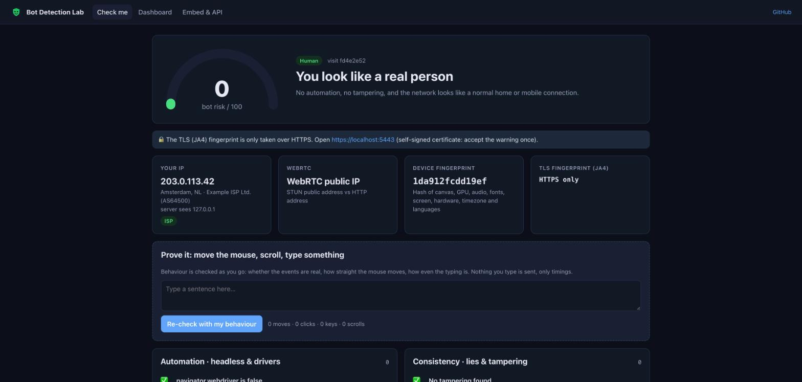
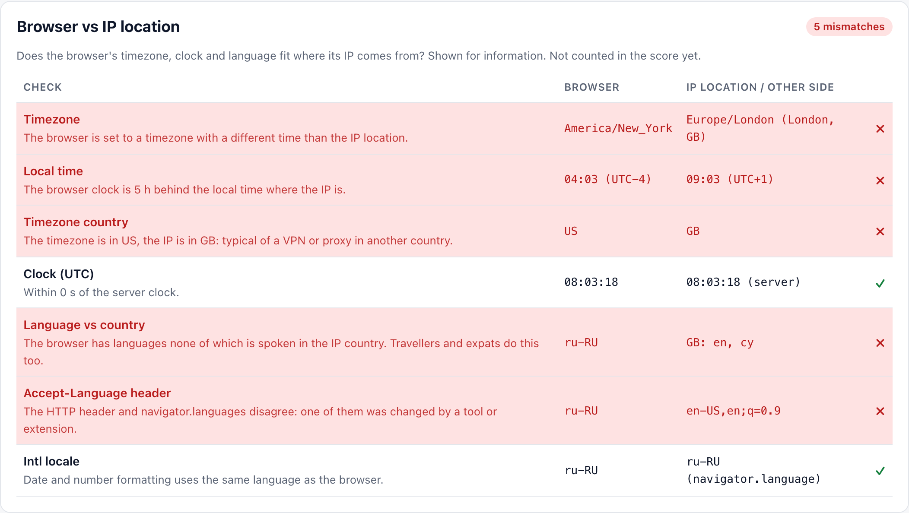
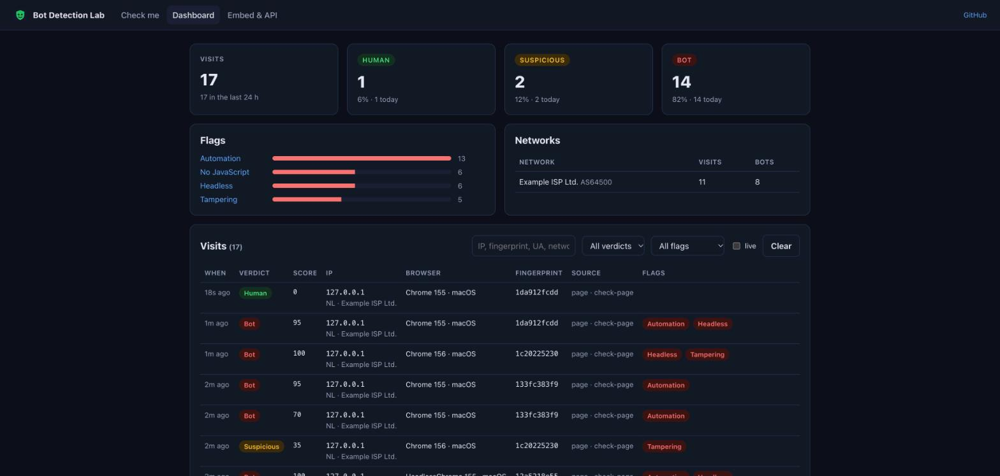
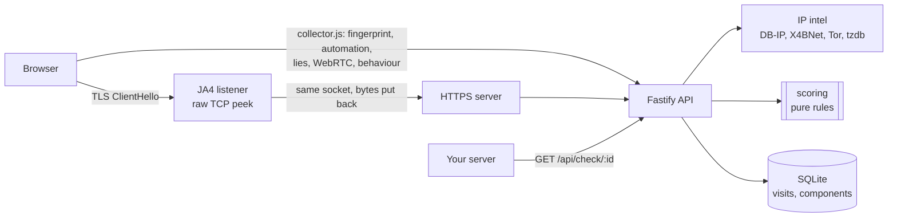

# Bot Detection Lab

[](https://github.com/allimist/bot-detection-lab/actions/workflows/ci.yml)


[](LICENSE)



**Is this visitor a real customer or a bot?** Open the page and it tells you, with a reason for every point:

- 🖐️ your **browser fingerprint**: canvas, WebGL, audio, fonts, screen, hardware, timezone, plus how rare each value is
- 🌍 whether you're behind a **VPN, proxy, Tor or a datacenter IP**, using WebRTC leaks, timezone vs IP country, and proxy headers
- 🤖 whether the browser is **automated**: Selenium, Puppeteer, Playwright, headless Chrome, **stealth plugins**
- 🎭 whether something is **lying**: patched native functions, an iframe or Web Worker that disagrees with the page, fake Client Hints, a User-Agent that doesn't match the JS engine
- 🔐 the **JA4 TLS fingerprint**, read from the raw ClientHello in plain Node. A Python script with a copied Chrome User-Agent still shakes hands like Python.
- 🖱️ **behaviour**: synthetic events, robot-straight mouse paths, metronome typing
- 🗺️ **browser vs IP location**: timezone, local time, clock, languages, Accept-Language and locale, compared with where the IP is. Mismatches are shown in red.



Then it adds everything up into a **bot risk score from 0 to 100** and a verdict: `human`, `suspicious` or `bot`.

It is also a drop-in tool for your own site: one `<script>` tag plus a server-side `GET /api/check/:id`, for signup forms, checkouts or paid-traffic landing pages (e.g. click fraud in an affiliate tracker). Everything runs on your server. There's no third-party fingerprinting service and no API key; IP data comes from free offline datasets.

It's a learning project in the same spirit as [`hotel-booking-lab`](https://github.com/allimist/hotel-booking-lab), [`flight-booking-lab`](https://github.com/allimist/flight-booking-lab), [`food-delivery-lab`](https://github.com/allimist/food-delivery-lab) and [`dating-sim-lab`](https://github.com/allimist/dating-sim-lab).

## What the bots get

`npm run bots` attacks the running app with the usual toolkits and writes this table. Real Chrome, driven by a person, scores **0 (human)**.

<!-- from docs/bot-results.md -->
| Client | Verdict | Risk | Main reasons |
|---|---|---|---|
| curl | 🔴 bot | 100 | User-Agent says curl (+50) · No JavaScript (+40) · No Accept-Language (+15) |
| Python urllib | 🔴 bot | 100 | User-Agent says python-urllib (+50) · No JavaScript (+40) · No Accept-Language (+15) |
| Python with copied Chrome headers | 🔴 bot | 80 | No JavaScript (+40) · TLS without ALPN (+40) |
| Node https with Chrome User-Agent | 🔴 bot | 100 | No JavaScript (+40) · TLS without ALPN (+40) · No Client Hints header (+20) · No Sec-Fetch headers (+15) |
| Playwright headless (default shell) | 🔴 bot | 100 | navigator.webdriver is true (+60) · HeadlessChrome (+60) · Inconsistent permissions (+25) · Software GPU (+25) |
| Playwright headless Chromium (new headless) | 🔴 bot | 100 | navigator.webdriver is true (+60) · HeadlessChrome (+60) · No speech voices (+5) |
| Puppeteer headless | 🔴 bot | 100 | navigator.webdriver is true (+60) · HeadlessChrome (+60) · Screen is 800×600 (+15) |
| **Puppeteer + stealth plugin** | 🔴 bot | 100 | Web Worker disagrees with the page (+30) · Fake Client Hints (+30) · GPU name from an old or spoofed Chrome (+20) · Screen is 800×600 (+15) |
| Selenium + ChromeDriver headless | 🔴 bot | 100 | navigator.webdriver is true (+60) · Automation framework found (+60) · HeadlessChrome (+60) · Screen is 800×600 (+15) |
| Playwright, real Chrome window | 🔴 bot | 65 | navigator.webdriver is true (+60) · No speech voices (+5) |
| Playwright, real Chrome + scripted mouse & typing | 🔴 bot | 90 | navigator.webdriver is true (+60) · Metronome typing (+25) · No speech voices (+5) |

The stealth plugin is the interesting one. It hides `navigator.webdriver`, fakes plugins and the GPU name, and patches `Function.prototype.toString` so its replacements look native. But it only patches the page. A **Web Worker** in the same tab still reports the real GPU (SwiftShader), the real languages and the real CPU count. Its fake Client Hints also use values real Chrome never produces (`platform: "Mac OS X"`, `platformVersion: "10_15_7"`, `fullVersion: "156.0.0.0"`).

## Run it

```bash
npm install
npm run data        # downloads the free IP datasets (~135 MB) into ./data: optional, but needed for VPN/Tor/ASN checks
npm start           # builds the web app and serves everything
```

| Address | What |
|---|---|
| http://localhost:5178 | the app: Check me, Dashboard, Embed & API |
| https://localhost:5443 | the same app over HTTPS **with JA4 TLS fingerprinting** (self-signed cert: accept the warning once) |

For development, `npm run dev` runs the API with reload plus Vite on http://localhost:5179.

Or with containers: `docker compose up -d --build` (or `podman compose up -d --build`). The container downloads the datasets into a volume on first start.

Needs **Node 22.13+** (the visit history uses the built-in `node:sqlite`). There is no database server, Redis or Kafka this time.

### Try to fool it

```bash
npm run bots                    # every scenario (opens a Chrome window for the headful ones)
npm run bots -- --no-headful    # headless only
npm run bots -- --only=stealth,curl
curl -k https://localhost:5443/api/inspect   # what a plain HTTP client gets
```

Then turn on a VPN and reload the Check page. The network checks light up: datacenter IP, VPN range, the browser timezone vs the IP country, and WebRTC leaking your real IP if the VPN doesn't cover UDP.



## How it works



The pieces, each small enough to read in one sitting:

| Path | What it does |
|---|---|
| [`packages/scoring`](packages/scoring/src) | **Pure rules engine.** `score(signals)` returns the score, verdict, flags and findings. No I/O, fully unit-tested with fixture signal sets (human Chrome, headless, stealth, VPN, Tor, curl, UA switcher…). |
| [`packages/collector`](packages/collector/src) | Browser side, no dependencies, about 17 KB minified. Fingerprint, automation hints, lie detection (native-function checks across realms, iframe and Worker comparisons), WebRTC STUN, behaviour tracker. |
| [`apps/api/src/tls.ts`](apps/api/src/tls.ts) | The **JA4** trick: a `net.Server` reads the ClientHello, computes JA4, then `unshift`s the bytes and hands the socket to the normal `https.Server`, so no nginx module or Go sidecar is needed. |
| [`apps/api/src/intel.ts`](apps/api/src/intel.ts) | Offline IP intel: DB-IP Lite city + ASN (mmdb), 45k datacenter / VPN CIDRs in a binary-searched range set, datacenter ASNs, Tor exits, IANA tz → country. |
| [`apps/api/src/db.ts`](apps/api/src/db.ts) | `node:sqlite` visit store, velocity counters (one device from many IPs, many devices from one IP) and per-component rarity. |
| [`apps/web`](apps/web/src) | React 19 + Vite: Check me, Dashboard (live), Embed docs. |
| [`scripts/bots`](scripts/bots/run.ts) | The attack harness above. |

More detail on every signal and why it works: [ARCHITECTURE.md](ARCHITECTURE.md).

## Use it on your site

```html
<script src="https://your-host/collector.js" data-auto data-site="signup"></script>
<script>
  addEventListener('botcheck', (e) => { form.visitId.value = e.detail.visitId; });
</script>
```

```js
// on your server, when the form arrives
const r = await fetch(`https://your-host/api/check/${visitId}`, {
  headers: { authorization: `Bearer ${process.env.BOTCHECK_TOKEN}` },
}).then((r) => r.json());
if (r.result.verdict === 'bot') reject();
if (r.result.flags.includes('vpn')) review();
```

The bot never sees the verdict it has to beat: the score is computed and stored on the server, and your backend reads it from there. The Embed page in the app has the full API.

## Configuration

| Env | Default | |
|---|---|---|
| `PORT` / `HTTPS_PORT` | `5178` / `5443` | `HTTPS_PORT=0` turns the HTTPS + JA4 listener off |
| `TLS_CERT`, `TLS_KEY` | self-signed | real certificate files, so Node terminates TLS itself and can read JA4 |
| `TRUST_PROXY` | off | set to `1` behind your own reverse proxy (then JA4 is not available) |
| `API_TOKEN` | none | protects the dashboard API and `/api/check/:id` |
| `CORS_ORIGIN` | any | comma-separated origins allowed to post visits |
| `DATA_DIR`, `DB_PATH` | `./data` | datasets, certificate and SQLite file |

## Limits, honestly

- **Scores, not proof.** Every rule is a heuristic with a weight. VPN users, privacy browsers (Brave, Tor Browser, Firefox with `resistFingerprinting`) and spoofing extensions will look "suspicious" because, technically, they are hiding something. Decide per flag what that means for your site.
- The classic **CDP detection** (`console.debug` reading `Error.stack`) is in the code, but current Chrome no longer leaks through it. It still catches some older driver setups.
- **Anti-detect browsers** that patch Chromium itself (not JS) are a different league. These checks raise their cost; nothing client-side makes it zero.
- IP datasets are only as fresh as your last `npm run data` (run it monthly). DB-IP Lite is country / city accurate, not street accurate.
- Fingerprints are hashed and stored with the visit for velocity and rarity. If you deploy this publicly, put the dashboard behind `API_TOKEN` and tell your visitors.

## Data sources

[DB-IP](https://db-ip.com) IP to City Lite and ASN Lite (CC BY 4.0) · [X4BNet/lists_vpn](https://github.com/X4BNet/lists_vpn) datacenter and VPN ranges (MIT) · [Tor Project](https://check.torproject.org/torbulkexitlist) exit list · [IANA tz database](https://github.com/eggert/tz) · JA4 by [FoxIO](https://github.com/FoxIO-LLC/ja4) (the JA4 TLS client fingerprint is BSD 3-Clause).

## License

MIT
